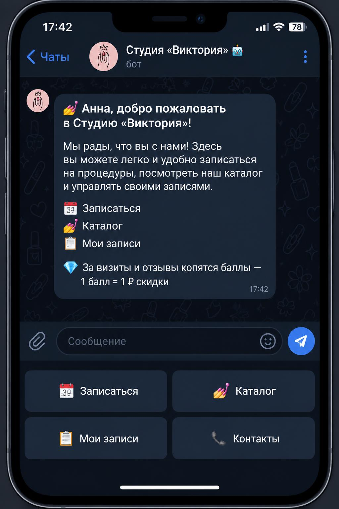
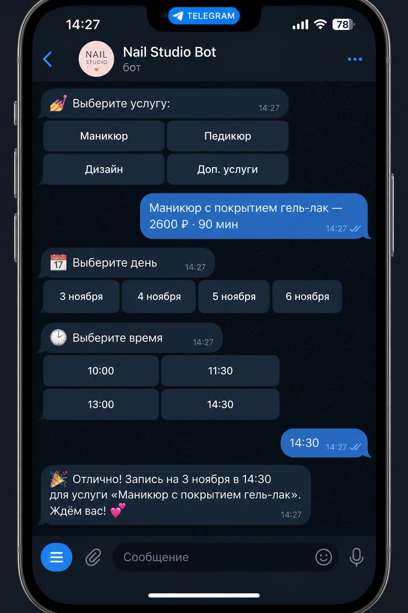
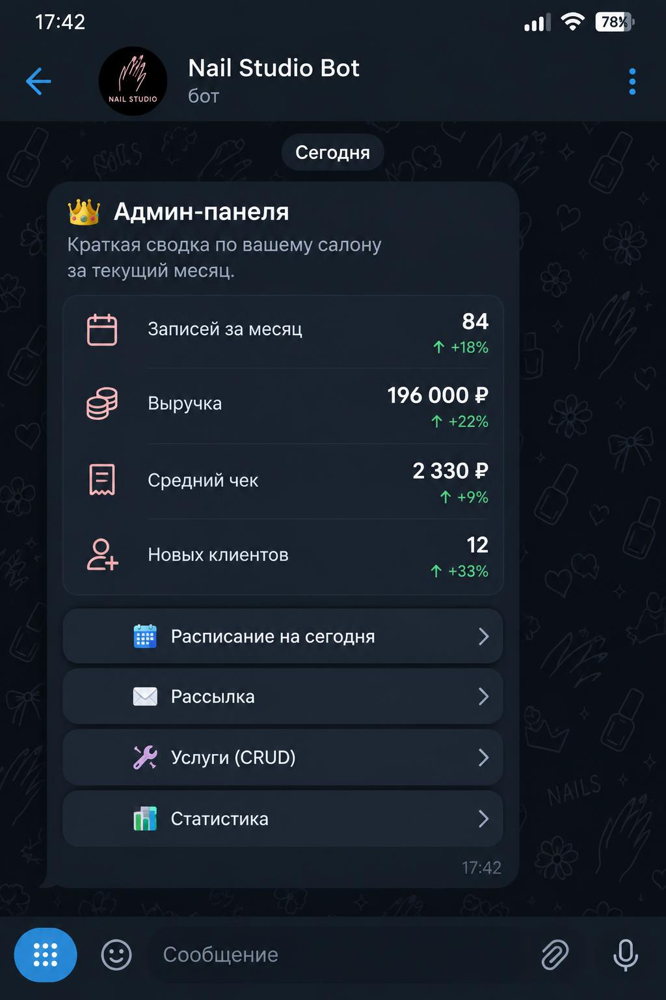

# nail-studio-bot 💅

[](https://github.com/mrkoster1988/nail-studio-bot/actions/workflows/ci.yml)


Бот студии маникюра и педикюра: запись клиентов, каталог услуг, бонусы,
админ-панель и синхронизация с Google Calendar. Telegram + VK + MAX.

## Возможности

### Клиент
- **Запись в 4 шага** — услуга → день → время → подтверждение (FSM)
- **Каталог** — цены, длительность, описания услуг
- **Мои записи** — просмотр, отмена, перенос
- **Бонусы** — баллы за визиты и отзывы (1 балл = 1 ₽ скидки), реферальные ссылки
- **Напоминания** — за 24 часа и за 2 часа до визита
- **Отзывы** — автоматический сбор после визита

### Админ
- Статистика: записи, выручка, средний чек, новые клиенты
- Расписание на сегодня/завтра, утренний дайджест в 9:00
- Рассылки, CRUD услуг
- Уведомления о новых заявках (в т.ч. из VK)

### Под капотом
- Защита от двойной записи: уникальный индекс на активные слоты + атомарный `try_add_booking`
- Google Calendar: создание/обновление/удаление событий
- Бэкап базы ежедневно (SQLite backup API, ротация 14 копий)
- Webhook-режим с HMAC-SHA256 подписью или long polling
- Docker-деплой с healthcheck
- CI: тесты при каждом пуше (`.gitlab-ci.yml`)

## Скриншоты

### Приветствие


### Запись: услуга → день → время


### Мои записи и баллы


### Админ-панель


## Стек

- Python 3.11, aiogram 2.x
- SQLite (обёртка в `database.py`)
- Docker / docker-compose

## Установка

```bash
git clone https://gitlab.com/alex.kosterov/nail-studio-bot.git
cd nail-studio-bot
cp .env.example .env   # заполнить токены
docker-compose up -d --build
```

## Запуск без Docker

```bash
pip install -r requirements.txt
python bot.py        # режим polling
WEBHOOK_MODE=1 python bot.py   # режим webhook
```

## Тесты

```bash
python -m unittest test_scheduling test_database -v
```

## Структура

```
bot.py             # точка входа (polling / webhook)
handlers_client.py # клиентские сценарии
handlers_admin.py  # админ-панель
database.py        # SQLite: записи, услуги, бонусы
scheduling.py      # слоты, рабочие дни/часы
reminders.py       # напоминания + утренний дайджест
webhooks.py        # webhook-сервер
vk_bot.py          # VK-бот (запись)
max_bot.py          # MAX-бот
gcal_sync.py        # Google Calendar
backup.py           # бэкап базы с ротацией
telegram_notify.py  # уведомления админам из внешних каналов
```

## Лицензия

MIT — см. [LICENSE](LICENSE).
